# Dengue Outlook: architecture

> **Historical-replay demonstration.** Forecasts are computed by a trained model on bundled weekly records
> that end on 2025-12-29. This is not live surveillance, not 2026 forecasting, not an official public-health
> warning service and not a clinically validated tool.

## 1. System overview

Two separate lifecycles:

- **Offline preparation (notebook, already run):** the historical dataset becomes per-ward lag features, is split
  chronologically, and is used to select and evaluate an XGBoost regressor, which is exported as portable
  artifacts. Nothing is trained or refitted while the app runs.
- **Runtime historical replay (local):** a React dashboard calls a FastAPI backend that loads the saved model
  once and answers read-only requests for any ward and historical issue week. Only `127.0.0.1` traffic is needed.

## 2. Diagram

```mermaid
flowchart LR
  subgraph OFFLINE["Offline preparation (notebook, already run)"]
    D[("Historical weekly dataset<br/>60 wards x 522 weeks")] --> F["Per-ward lag and ward features<br/>ml/features.py"]
    F --> S["Chronological split with 4-week purge<br/>train / validation / test"]
    S --> M["XGBoost regressor<br/>chosen on validation MAE"]
    M --> A["Portable artifacts<br/>.ubj / .json, fitted preprocessor, manifest"]
  end
  subgraph RUNTIME["Runtime historical replay (local, no external services)"]
    U["User picks city, ward, issue week"] --> R["React dashboard<br/>127.0.0.1:5173"]
    R -->|"GET /meta, /forecast, /forecast/ward_id"| API["FastAPI backend<br/>127.0.0.1:8000"]
    API --> P["PortableForecaster<br/>loaded once at startup"]
    P --> T["Feature row for ward and issue week<br/>in-memory table built at startup"]
    T --> X["Preprocessor + XGBoost booster"]
    X --> O["Predicted cases, tier, early alert, drivers"]
    O -->|"JSON, mode = historical_replay"| R
  end
  A -.->|"loaded and hash-checked at startup"| P
  D -.->|"same CSV bundled with the app"| T
```

## 3. Data and features

- **Data:** `ml/data/dengue_dataset.csv`: 31,320 rows = 60 wards x 522 weeks (Mondays 2016-01-04 to
  2025-12-29) in five city corporations (Dhaka North 20, Dhaka South 20, Chattogram 10, Gazipur 5,
  Narayanganj 5). Columns: temperature (avg, max, min), rainfall, humidity, dengue cases, and three static ward
  attributes (population density, water-logging risk, sanitation score).
- **Features** (`ml/features.py`): 30 numeric inputs plus `city` and `ward_id` (95 columns after one-hot
  encoding). Numeric inputs: static ward attributes; issue-week weather; rainfall, temperature and humidity lags
  for 1 to 4 weeks; rolling rainfall sums over 2, 3 and 4 weeks; case lags for 1 to 4 weeks and their mean; month
  as sine and cosine.
- **Known at issue time:** week *t*'s weather and earlier weeks. **Week *t*'s own case count is excluded**
  (`model_config.json` records the assumption). Lags are exact calendar shifts within one ward, so a record gap
  gives a missing value, never another ward's or week's. The first usable issue week is 2016-02-01.

## 4. Forecast target

For ward *w* and issue week *t*: `y_hat(w, t) ~ cases(w, t+2) + cases(w, t+3) + cases(w, t+4)`.

This is **one combined total**, not three weekly forecasts, clipped at 0 before tiers are assigned. It is an
estimate, not a confirmed outbreak. The dashboard shows the observed total for the same weeks only as a
separate historical comparison; it is never an input.

## 5. Model selection and validation

- **Chronological split, never random.** Cutoffs at 70% and 85% of the weekly dates, each preceded by a
  **4-week purge** so no target window (weeks *t*+2 to *t*+4) crosses into the next period:
  train 2016-02-01 to 2022-11-21 (21,360 rows), validation 2022-12-26 to 2024-05-13 (4,380), test
  2024-06-17 to 2025-12-01 (4,620). The final model is refitted on train plus validation (25,740 rows) and
  scored once on the test period.
- **Selection:** XGBoost had the lowest validation MAE (2.137), against Hist Gradient Boosting 2.200, Extra Trees
  2.250, Random Forest 2.514 and a mean baseline 10.202. Log target, sample weights, adding week *t* cases and
  a 25-configuration randomized search did not improve it. XGBoost also gives exact TreeSHAP attributions for
  the driver bars.
- **Leakage controls** ([`ml/model_report.md`](ml/model_report.md)): case lags start at *t*-1; features for week
  *t* were checked to be unchanged when later records are removed or scrambled; the target is built only from
  later weeks and never at inference.
- **Test results** (4,620 ward-weeks, clipped as served): MAE 2.776, RMSE 4.922, R-squared 0.813. The seasonal
  baseline (ward x week-of-year mean) has MAE 3.223, so the model is 13.9% lower; last-week persistence has
  7.220 ([`ml/eval/metrics_summary.json`](ml/eval/metrics_summary.json)).
- **Weaknesses:** over-forecasting in June (mean bias +4.3 cases) and September (+3.5), under-forecasting of
  the largest outbreaks, city MAE from 2.59 to 3.23, and a 5.7% gain over the seasonal baseline in 2025 in the
  report's rolling-origin check.

## 6. Risk tiers and early alert

| Tier | Predicted combined cases *p* |
| --- | --- |
| Low | `p < 4.5` |
| Medium | `4.5 <= p < 14.5` |
| High | `14.5 <= p < 30.5` |
| Critical | `p >= 30.5` |

The **early alert** is separate: `predicted_cases_3wk > 25` (best validation F1 for detecting observed totals
above 30). On the test period it fired 649 times, 232 for ward-weeks with an observed total above 30 and 417
for others, and it missed 36 of 268 (precision 0.357, recall 0.866). Both rules are provisional, defined in
[`ml/model_config.json`](ml/model_config.json) and applied by the ML package the backend calls; the frontend
only displays them. Neither is a verified public-health warning.

## 7. Runtime components and API flow

- **Artifacts:** `ml/dengue_xgboost_model.ubj` (fallback `.json`), the fitted preprocessor
  `ml/dengue_preprocessor.joblib` (fallback `.json`) and `ml/portable_manifest.json` (SHA-256 hashes). The
  original combined joblib *model-loading* path does not load on the project's Windows setup and is **not** used:
  `ml/predict_portable.py` inherits the feature, tier and driver logic of `ml/predict.py` but never calls its
  loader (a backend test patches that constructor to raise). Portable tests check its predictions match the
  original pipeline's.
- **Lifecycle:** the FastAPI lifespan calls `load_portable_forecaster()` once
  ([`backend/app/model_service.py`](backend/app/model_service.py)): hashes are verified, the booster and
  preprocessor are loaded, and features for all 31,320 ward-weeks are built in memory. Requests read from
  memory (a test asserts one load, not one per request). If loading fails, `/health` shows `model_ready: false`
  and model endpoints return 503 `model_unavailable`; no prediction is invented.
- **Endpoints** ([`backend/app/main.py`](backend/app/main.py)), all read-only `GET`: `/health`; `/meta` (cities,
  60 wards, valid weeks, tier edges, alert threshold); `/forecast/{ward_id}?issue_date=` (drivers on by
  default); `/forecast?issue_date=` (all 60 wards, drivers off by default). `issue_date` must be a Monday in the
  data range.
- **Responses:** the ML result (prediction, `risk_tier`, `early_alert`, forecast weeks, drivers, observed
  outcome) is passed through unchanged in an envelope with `mode: "historical_replay"` and a limitation notice.
  Errors share one JSON shape (400, 404, 422, 503, 500) with no tracebacks or paths. `forecast_from_records`
  exists in the ML package but is not exposed over HTTP.
- **Drivers:** XGBoost TreeSHAP contributions grouped into 8 input groups, with a baseline. They are additive
  attributions of the model's output, not proof of cause.
- **Frontend** (`frontend/src`): a typed client validates responses, times out after 15 s and ignores stale
  responses when the selection changes. It sends `GET` requests only.

## 8. Compute, cost and API controls

Verified in code or tests:

- **Local CPU inference.** No hosted inference, live weather API, database or other external service at
  runtime, and no LLM calls, so no token costs exist to control. AI assistants were used only during
  development (see [`README.md`](README.md)).
- **Model reuse:** one load per process; requests never reload or retrain.
- **Conservative threads:** the loader sets `OMP_NUM_THREADS=1` by default, before XGBoost is imported, and
  `n_jobs=1` on the regressor.
- **Few requests:** one batched call returns all 60 wards for a week; the dashboard asks for drivers only for the
  selected ward, and sends no polling or background requests. There is no server-side cache.

Startup-command conventions, not enforced by code: `uvicorn ... --host 127.0.0.1 --port 8000 --workers 1` (one
worker, localhost, no reload). The default CORS allow-list (`localhost` / `127.0.0.1`, ports 3000 and 5173) is in
`backend/app/config.py`. Latency figures in [`ml/integration_guide.md`](ml/integration_guide.md) came from a
2-vCPU Linux machine and were not re-measured.

## 9. Limitations

- **Historical replay only:** the data end on 2025-12-29.
- **Data provenance:** the project report finds the data appear simulated (identical max and min temperatures
  across wards each week; rainfall correlated at 0.991 or more between all ward pairs). Results describe this
  dataset, not real surveillance.
- **Error and uncertainty:** no prediction intervals are implemented; the alert gives many false alerts on the
  test period; the largest outbreaks are under-forecast. Tiers use absolute counts (no population data).
- **Attribution is not causation.**
- **Loader compatibility:** the original joblib pipeline has known Windows loading problems; the portable format
  is the supported path. The legacy `ml/tests/test_package.py` targets that loader and fails on Windows.

Further detail: [`ml/model_report.md`](ml/model_report.md), [`backend/README.md`](backend/README.md),
[`frontend/README.md`](frontend/README.md).
