```mermaid
flowchart LR
  subgraph OFFLINE["Offline preparation (notebook, already run)"]
    D[("Historical weekly dataset<br/>60 wards x 522 weeks")] --> F["Per-ward lag and ward features<br/>ml/features.py"]
    F --> S["Chronological split with 4-week purge<br/>train / validation / test"]
    S --> M["XGBoost regressor<br/>chosen on validation MAE"]
    M --> A["Portable artifacts<br/>.ubj / .json, fitted preprocessor, manifest"]
  end
  subgraph RUNTIME["Runtime historical replay (local, no external services)"]
    U["User picks city, ward, issue week"] --> R["React dashboard<br/>127.0.0.1:5173"]
    R -->|"GET /meta, /forecast, /forecast/ward_id"| API["FastAPI backend<br/>127.0.0.1:8000"]
    API --> P["PortableForecaster<br/>loaded once at startup"]
    P --> T["Feature row for ward and issue week<br/>in-memory table built at startup"]
    T --> X["Preprocessor + XGBoost booster"]
    X --> O["Predicted cases, tier, early alert, drivers"]
    O -->|"JSON, mode = historical_replay"| R
  end
  A -.->|"loaded and hash-checked at startup"| P
  D -.->|"same CSV bundled with the app"| T
```

# Dengue Outlook: architecture

> **Historical-replay demonstration:** a trained model replays bundled weekly records that end on 2025-12-29. This is not
> live surveillance, not 2026 forecasting, not an official warning service and not clinically validated.

## 1. Overview and diagram

**Offline preparation** (notebook, already run) produces portable model artifacts; nothing is trained while the app runs.
**Runtime replay** (local, `127.0.0.1` only): a React dashboard calls a FastAPI backend that loads the model once.

## 2. Data, features and target

- **Data** (`ml/data/dengue_dataset.csv`): 60 wards (Dhaka North 20, Dhaka South 20, Chattogram 10, Gazipur 5, Narayanganj
  5) x 522 weekly records (2016-01-04 to 2025-12-29): weather, dengue cases and static ward vulnerability (population
  density, water-logging risk, sanitation).
- **Features** (`ml/features.py`; 30 numeric inputs plus `city`, `ward_id`): ward attributes; issue-week weather; rainfall,
  temperature and humidity lags of 1 to 4 weeks; rolling rainfall sums over 2, 3 and 4 weeks; case lags; month. Lags are
  calendar shifts within one ward. Only issue week *t* and earlier is used; **week *t*'s own case count is excluded**.
- **Target:** `y_hat(w, t) ~ cases(t+2) + cases(t+3) + cases(t+4)`: **one combined total**, not three weekly forecasts,
  clipped at 0; an estimate, not a confirmed outbreak. Observed totals appear only as a separate dashboard comparison.

## 3. Model and validation

- **Chronological split, never random,** with a **4-week purge** before each cutoff: train 2016-02-01 to 2022-11-21
  (21,360 rows), validation 2022-12-26 to 2024-05-13 (4,380), test 2024-06-17 to 2025-12-01 (4,620). The final model is
  refitted on train plus validation and scored once on test.
- **Why XGBoost:** lowest validation MAE (2.137, against 2.200 to 2.514 for Hist Gradient Boosting, Extra Trees and Random
  Forest) and exact TreeSHAP attributions. Leakage checks: [`ml/model_report.md`](ml/model_report.md).
- **Test** (4,620 ward-weeks, clipped as served): MAE 2.776, RMSE 4.922, R-squared 0.813; seasonal baseline MAE 3.223
  (model 13.9% lower) ([`ml/eval/metrics_summary.json`](ml/eval/metrics_summary.json)).

## 4. Risk tiers and early alert

Tiers on the clipped predicted combined total *p*: **Low** `p < 4.5`; **Medium** `4.5 <= p < 14.5`; **High**
`14.5 <= p < 30.5`; **Critical** `p >= 30.5`. The **early alert** is separate: `predicted_cases_3wk > 25` (best validation
F1 for observed totals above 30). On test it fired 649 times (232 for observed totals above 30, 417 not) and missed 36 of
268 (precision 0.357, recall 0.866). Both are provisional ([`ml/model_config.json`](ml/model_config.json)), not verified
warnings.

## 5. Runtime and API

- **Portable inference:** native booster `ml/dengue_xgboost_model.ubj` and fitted preprocessor
  `ml/dengue_preprocessor.joblib` (both with `.json` fallbacks), checked against a SHA-256 manifest. The original
  combined-joblib loader does not load on the project's Windows setup and is **not** used. The FastAPI lifespan loads the
  model once ([`backend/app/model_service.py`](backend/app/model_service.py)) and builds features for 31,320
  ward-weeks in memory; on failure `/health` shows `model_ready: false` and model endpoints return 503.
- **Endpoints** ([`backend/app/main.py`](backend/app/main.py)), read-only `GET`: `/health`, `/meta`,
  `/forecast/{ward_id}?issue_date=` (with drivers), `/forecast?issue_date=` (all 60 wards); `issue_date` is a Monday in the
  data range. Responses carry `mode: "historical_replay"`; errors share one JSON shape with no tracebacks.
- **Drivers and frontend:** TreeSHAP contributions in 8 groups are attributions, not causes; the frontend is a typed,
  `GET`-only client that ignores stale responses.

## 6. Compute and cost controls

- **Code-enforced:** local CPU inference; no hosted inference, weather API, database or LLM calls (so no token costs);
  one model load per process; `OMP_NUM_THREADS=1` by default and `n_jobs=1`; no server cache; one batched call for 60
  wards, drivers only for the selected ward.
- **Convention, not enforced:** `uvicorn app.main:app --host 127.0.0.1 --port 8000 --workers 1`.

## 7. Limitations

The data appear simulated (identical max and min temperatures across wards; rainfall correlated at 0.991 or more between
all ward pairs), so results describe this dataset, not real surveillance. There are no prediction intervals; the test
period shows many false alerts, over-forecasting in June and September and under-forecasting of the largest outbreaks;
attribution is not causation.
