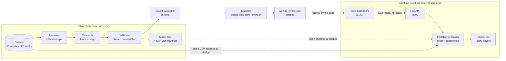

# Dengue Outlook: architecture

> Historical-replay prototype: a trained model replays weekly records that end on 2025-12-29. It is not live
> surveillance, not a 2026 forecast and not an official warning system.

## 1. Overview

The model is trained once, offline. At runtime a FastAPI backend loads the saved model, builds features from the
bundled CSV, and a React dashboard requests forecasts from it on `127.0.0.1`. The validation dashboard is
separate: it reads a static JSON file made from the saved evaluation predictions.

## 2. Data and features

`ml/data/dengue_dataset.csv` has 31,320 rows: 60 wards in five city corporations (Dhaka North 20, Dhaka South 20,
Chattogram 10, Gazipur 5, Narayanganj 5) x 522 weekly records (Mondays, 2016-01-04 to 2025-12-29).

`ml/features.py` serves both training and inference. It builds 30 numeric and 2 categorical inputs (95 columns
after one-hot encoding): week-*t* weather, rainfall, temperature and humidity lags of 1 to 4 weeks, rainfall sums
over 2, 3 and 4 weeks, dengue-case lags and their 4-week mean, month (sine, cosine), three ward attributes, and
city and ward. Lags are exact calendar shifts inside one ward, and week *t*'s own cases are not used.

The target is the cases in weeks t+2, t+3 and t+4 added together: one number per ward and issue week.
Predictions are clipped at 0.

## 3. Model and validation

Weeks are split by time, with a 4-week purge before each cutoff so no target window crosses into the next period.

| Period | Issue weeks | Rows |
| --- | --- | --- |
| Train | 2016-02-01 to 2022-11-21 | 21,360 |
| Validation | 2022-12-26 to 2024-05-13 | 4,380 |
| Test | 2024-06-17 to 2025-12-01 | 4,620 |

XGBoost was chosen for the lowest validation MAE: 2.1371, against 2.2004 (Hist Gradient Boosting), 2.2503 (Extra
Trees), 2.5142 (Random Forest) and 10.2024 (predicting the mean). It also gives exact TreeSHAP explanations.
The final model is refitted on train plus validation (25,740 rows). Validation guided model and alert-threshold
choice; the test period is the held-out evaluation.

On test (clipped, 4,620 ward-weeks) MAE is 2.7762, RMSE 4.9225 and R-squared 0.813; a seasonal baseline has
MAE 3.2232.

**Tiers** on the clipped total *p*: Low `p < 4.5`, Medium `4.5 <= p < 14.5`, High `14.5 <= p < 30.5`, Critical
`p >= 30.5`. **Early alert:** `p > 25`, the best validation F1 for observed totals above 30. On test it fired 649
times (232 correct, 417 false) and missed 36 of 268. Both are provisional choices, not official thresholds.

## 4. Backend and frontend

- **FastAPI** (`backend/app/main.py`): read-only `GET /health`, `/meta`, `/forecast/{ward_id}` and `/forecast`
  (all 60 wards in one batched model call). Responses carry `mode: "historical_replay"`.
- **Portable inference** (`ml/predict_portable.py`): loads the native XGBoost file and fitted preprocessor,
  checks their SHA-256 hashes, and builds the feature table once at startup. The original joblib loader does not
  load on our Windows setup and is not used. If loading fails, `/health` reports `model_ready: false` and model
  routes return 503.
- **Drivers:** TreeSHAP contributions in 8 input groups, explaining the model's number, not causes.
- **React + TypeScript** (`frontend/src`): a `GET`-only client that checks responses and ignores outdated ones.
  It shows the ward forecast, five city charts, a ward list and an English/Bangla interface.

## 5. Evaluation dashboard

`ml/tools/export_validation_errors.py` reads the saved test, validation and rolling-origin predictions in
`ml/eval/` (standard library only), recomputes weekly and pooled MAE and RMSE, checks them against
`metrics_summary.json`, and writes `frontend/public/validation/weekly_errors.json`. The page fetches and
validates that file. No model runs.

- Validation: 73 weeks, 4,380 predictions, pooled MAE 2.1371, RMSE 4.3730.
- Test: 77 weeks, 4,620 predictions, pooled MAE 2.7762, RMSE 4.9225.
- Pooled RMSE uses all rows, not the average of weekly RMSEs. The yearly rolling-origin table is a different
  retraining scheme and is shown separately.

## 6. Compute and API use

No external APIs at runtime (no hosted inference, LLM, weather service or database). The model is loaded once per
process, with `OMP_NUM_THREADS=1` and XGBoost `n_jobs=1` by default and no server-side cache. The UI sends one
request for the selected ward and one batched request for all wards, and cancels outdated ones. The
single-worker launch (`--workers 1` on `127.0.0.1`) comes from the command line.

## 7. Limitations

The data appear simulated (identical maximum and minimum temperatures in every ward, rainfall correlated at 0.991
or more between ward pairs), so results describe this dataset, not real surveillance, and real-world performance
is unverified. There are no prediction intervals, the alert gives many false alarms on test, and TreeSHAP
attributions are not causal. Validation figures may be optimistic.
