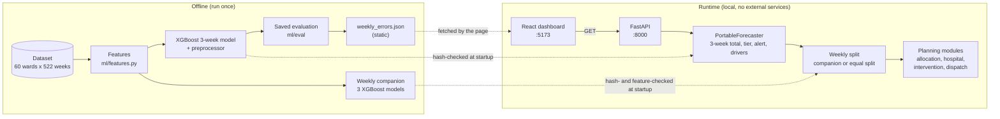

# Dengue Outlook: architecture

> Historical-replay prototype: trained models replay weekly records that end on 2025-12-29. It is not live
> surveillance, not a 2026 forecast and not an official warning system. The planning sections run scenarios on
> hypothetical inputs; nothing is sent, dispatched or transferred.

## 1. High-level architecture

The models are trained offline. At runtime a FastAPI backend loads the saved models once and builds the feature
table from the bundled CSV. A React dashboard then calls it on `127.0.0.1`. Every request works on the same
replayed data; nothing is fetched from outside.

There are two layers on the backend:

- **Forecasting:** the Phase 1 XGBoost model gives one 3-week case total per ward and issue week. The Phase 2
  weekly companion splits that total into weeks t+2, t+3 and t+4.
- **Planning:** pure Python modules turn one forecast run for all 60 wards into resource, hospital, intervention
  and dispatch scenarios. They never call the model themselves; they only use its output.

The validation dashboard is separate: it reads a static JSON file made from the saved evaluation predictions.



## 2. Data and features

`ml/data/dengue_dataset.csv` has 31,320 rows: 60 wards in five city corporations (Dhaka North 20, Dhaka South 20,
Chattogram 10, Gazipur 5, Narayanganj 5) x 522 weekly records (Mondays, 2016-01-04 to 2025-12-29).

`ml/features.py` serves both training and inference. It builds 30 numeric and 2 categorical inputs (95 columns
after one-hot encoding):

- week-*t* weather;
- rainfall, temperature and humidity lags of 1 to 4 weeks;
- rainfall sums over 2, 3 and 4 weeks;
- dengue-case lags and their 4-week mean;
- month (sine, cosine), three ward attributes, and city and ward.

Lags are exact calendar shifts inside one ward, and week *t*'s own cases are not used. The backend builds this
feature table once at startup; the planning modules read population density from the same table.

## 3. Machine learning pipeline

### 3-week model (Phase 1)

The target is the cases in weeks t+2, t+3 and t+4 added together: one number per ward and issue week.
Predictions are clipped at 0.

Weeks are split by time, with a 4-week purge before each cutoff so no target window crosses into the next period.

| Period | Issue weeks | Rows |
| --- | --- | --- |
| Train | 2016-02-01 to 2022-11-21 | 21,360 |
| Validation | 2022-12-26 to 2024-05-13 | 4,380 |
| Test | 2024-06-17 to 2025-12-01 | 4,620 |

XGBoost was chosen for the lowest validation MAE: 2.1371, against 2.2004 (Hist Gradient Boosting), 2.2503 (Extra
Trees), 2.5142 (Random Forest) and 10.2024 (predicting the mean). It also gives exact TreeSHAP explanations.
The final model is refitted on train plus validation (25,740 rows). Validation guided model and alert-threshold
choice; the test period is the held-out evaluation.

On test (clipped, 4,620 ward-weeks) MAE is 2.7762, RMSE 4.9225 and R-squared 0.813; a seasonal baseline has
MAE 3.2232.

**Tiers** on the clipped total *p*: Low `p < 4.5`, Medium `4.5 <= p < 14.5`, High `14.5 <= p < 30.5`, Critical
`p >= 30.5`. **Early alert:** `p > 25`, the best validation F1 for observed totals above 30. On test it fired 649
times (232 correct, 417 false) and missed 36 of 268. Both are provisional choices, not official thresholds.

### Weekly companion (Phase 2)

`ml/phase2/weekly_model.py` loads three XGBoost boosters (`weekly_w2.ubj`, `weekly_w3.ubj`, `weekly_w4.ubj`), one
per horizon week, trained on the same 95 columns. `weekly_config.json` records:

- the companion version (`weekly-xgb-2to4w-1.0.0`);
- the feature list;
- the hyperparameters (500 trees, learning rate 0.03, max depth 5, among others);
- the training rows (25,740 issue weeks, 2016-02-01 to 2024-05-13).

The models are not retrained in this repository. There is no saved evaluation of the weekly values.

## 4. Model artifacts and inference

- **3-week model:** `ml/predict_portable.py` (`PortableForecaster`) loads the native XGBoost file and the fitted
  preprocessor, checks their SHA-256 hashes against `ml/portable_manifest.json`, and builds the feature table
  once. The original joblib loader (`ml/predict.py`) does not load on our Windows setup and is not used.
- **Weekly companion:** before use it checks a lot against the loaded 3-week model:
  - each model file's SHA-256 against `ml/phase2/artifacts/SHA256SUMS` (the checked bytes are the ones loaded);
  - the numeric feature names and order, and the feature-set version;
  - the city and ward categories;
  - the 95 encoded column names of the fitted preprocessor;
  - each booster's input width.

  Any mismatch stops the companion from loading.
- **Startup** (`backend/app/model_service.py`): the 3-week model loads first, then the companion. If the 3-week
  model fails, `/health` reports `model_ready: false` and every model or planning route answers 503
  `model_unavailable`. If only the companion fails, everything still works with the equal split.
- **Drivers:** TreeSHAP contributions in 8 input groups, explaining the model's number, not causes.

## 5. Weekly forecast handling

`ModelService.attach_weekly` adds a `weekly` block to already-computed forecasts without changing any 3-week
field:

1. The companion predicts raw values for t+2, t+3 and t+4 from the same feature rows.
2. `reconcile` clips them at 0 and rescales them so they add up exactly to `predicted_cases_3wk` (equal thirds
   if all raw values are 0 or below). Because of this, the tier and alert can never change.
3. If the companion is not loaded, or it raises an error for this request, the block uses the equal split
   (`total / 3` per week).

The block records `source` (`companion` or `equal_split`) and `fallback_reason`:

- `companion_not_loaded`: the companion was never loaded (for example because the 3-week model failed first);
- `companion_unavailable`: loading the companion failed;
- `companion_inference_failed`: the companion failed for this request.

`/meta` reports the same status under `weekly_companion`. `/forecast` and `/forecast/{ward_id}` add the block
only with `include_weekly=true`. The planning endpoints always attach it, because bed demand and the
intervention scenarios work per week.

## 6. Backend structure

```text
backend/app/main.py            routes, query validation, response envelope, CORS
backend/app/model_service.py   loads both models once; forecast calls, weekly split, ward densities
backend/app/errors.py          JSON error format and handlers
backend/app/config.py          replay notice, CORS origins (DENGUE_CORS_ORIGINS)
backend/app/planning/
  parameters.py    every planning constant with its source and wording of assumptions
  demand.py        forecast -> integer saline, kit, bed and crew demand (Decimal, ROUND_HALF_UP)
  allocate.py      minimum coverage + risk priority allocation; budget split between cities
  hospital.py      within-city overflow routing for one city and week
  intervention.py  assumed-effect formula and the optional alternative crew ranking
  scenario.py      builds the full allocation, hospital and intervention responses
  dispatch.py      builds and renders draft briefs from the three scenarios above
backend/scripts/generate_exports.py   rebuilds or checks the sample briefs in exports/
```

The planning modules use only the standard library, with exact `Decimal` and `Fraction` arithmetic so that
results are deterministic and integer allocations add up exactly.

## 7. Frontend structure

```text
frontend/src/App.tsx                 shared selection (city, ward, issue week), section switching
frontend/src/api/client.ts           typed GET client: 15 s timeout, abort support, typed errors
frontend/src/api/validate.ts         runtime checks of every response before it is shown
frontend/src/lib/useRequest.ts       request hook: aborts superseded requests, ignores late answers
frontend/src/scenario/               scenario state, input validation and query builders
frontend/src/components/
  SectionNav.tsx                     the six section buttons
  Overview.tsx, WardDetail.tsx, WardCharts.tsx, DriversChart.tsx, ValidationDashboard.tsx, Methodology.tsx
  WeeklyOutlook.tsx, ResourcePlanning.tsx, HospitalPlanning.tsx, InterventionExplorer.tsx, DispatchBrief.tsx
  ScenarioControls.tsx, usePlanning.ts, PlanningParts.tsx   shared planning controls and request logic
  InfoButton.tsx                     small explanation popovers next to actions
frontend/src/i18n/                   English and Bangla dictionaries
```

The dashboard owns one selection (city, ward, issue week) that every section uses. Only one section is shown at
a time.

In the planning sections, edits change a draft only. Pressing Apply (or Generate for the brief) validates the
draft and sends exactly one request. A new issue week re-requests with the last applied values. The result line
shows the parameters the backend reports back, not the draft values.

## 8. API communication

All endpoints are `GET`. Every response except `/health` is wrapped as
`{"mode": "historical_replay", "notice": "...", ...}`. Issue dates must be Mondays from 2016-02-01 to 2025-12-29.
The four planning endpoints default to the last valid week when `issue_date` is left out, and each one runs
`forecast_all` for all 60 wards (without drivers or observed values) before planning.

| Endpoint | What it returns | Main query parameters |
| --- | --- | --- |
| `GET /health` | API status and `model_ready` | none |
| `GET /meta` | cities and wards, valid issue weeks, horizon, tier edges and rule, alert threshold, model version, weekly companion status | none |
| `GET /forecast/{ward_id}` | one ward's forecast: 3-week total, tier, alert, forecast weeks, drivers, observed later total for comparison, warnings | `issue_date` (required), `include_drivers` (default true), `include_weekly` (default false) |
| `GET /forecast` | all 60 wards for one week | `issue_date` (required), `include_drivers` (default false), `include_weekly` (default false) |
| `GET /allocation` | saline, kit and crew plan per ward, per city and in total | `stock_pct` 30-100 (default 100), `stock_pct_saline`, `stock_pct_kits` (optional overrides, same range), `min_coverage_pct` 0-50 (default 30), `total_crews` 0-10,000 (default 60) |
| `GET /hospital-routing` | weekly bed planning demand, hypothetical capacity, moves within each city, remaining shortfall | `capacity_pct` 25-200 (default 100) |
| `GET /intervention-simulation` | low/base/high scenarios per ward, city and region; optional alternative crew assignment | `total_crews`, `min_coverage_pct` (as above), `include_roi_alternative` (default false) |
| `GET /dispatch-brief` | draft brief as JSON, plain text or printable HTML | `scope` (`city` or `ward`, required), `city` or `ward_id`, `audience` (`resource`, `hospital`, `all`), `variant` (`short`, `detailed`), `format` (`json`, `text`, `html`), `stock_pct`, `min_coverage_pct`, `total_crews`, `capacity_pct`, `intervention_scenario` (`low`, `base`, `high`), `download` |

The dispatch endpoint does not take separate saline or kit stock levels. The frontend tells the user when those
overrides will not be used in a brief.

## 9. Planning modules

The four planning outputs are different kinds of numbers, and the responses label them that way.

| Output | What it is | What it is not |
| --- | --- | --- |
| Forecast | the model's expected 3-week cases (and its weekly split) | an observed count or a live prediction |
| Resource allocation | how a hypothetical stock would be shared out under a fixed rule | real inventory or a clinical optimum |
| Hospital routing | bed planning units moved between wards of one city against a hypothetical capacity | patients, admissions or real vacancies |
| Intervention scenarios | the forecast reduced by an assumed spraying effect | a causal or measured effect |
| Dispatch brief | a draft text built from the three scenarios above | an instruction that has been sent or approved |

### Demand conversion (`demand.py`)

- **Saline and kits:** `round_half_up(coefficient x 3-week total)` per ward. According to the notes in
  `parameters.py`, the coefficients (2.38485 and 1.16422) reproduce the planning columns of the onsite dataset,
  which is not in this repository. They are conventions, not clinical rules.
- **Bed planning demand:** `round_half_up(0.29844 x the busiest week's cases)`.
- **Crew demand:** 0 for Low-tier wards, otherwise `min(6, ceil(population density / 12,000))`. This is
  hypothetical.
- **Large forecasts:** forecasts above the largest observed 3-week total (92) are flagged, not capped.

### Resource allocation (`allocate.py`, `scenario.build_plan`)

Stock is pooled per city as `floor(stock_pct x city demand / 100)`. There are no transfers between cities.

The crew budget is a regional number. It is first split between cities by lowest coverage, then allocated
inside each city.

Inside a city, each resource is allocated in two stages:

1. **Minimum coverage:** units go one at a time to the ward with the lowest coverage among wards below
   `ceil(min_coverage_pct x demand / 100)`.
2. **Risk priority:** the rest fill wards in priority order: tier, then alert, then density, then forecast, then
   ward id.

The order does not depend on the stock size, so more stock never lowers any ward's allocation.

### Hospital routing (`hospital.py`, `scenario.build_hospital_routing`)

The city capacity baselines are hypothetical, in bed planning units: Chattogram 46, Dhaka North 87, Dhaka South
86, Gazipur 27, Narayanganj 21. Each is the 2016-2023 mean of each year's peak city-wide weekly bed demand.

- **Capacity:** `floor(capacity_pct x baseline / 100)`, split equally across the city's wards.
- **Routing:** each forecast week is handled on its own. Each ward first uses its own capacity. Overflow then
  moves one unit at a time from the least-served ward to the least-occupied ward in the same city.
- **Results:** what is left is reported as `unmet_after_routing`. Each city also gets a headline week.

There are no distances, travel times or hospital records.

### Intervention scenarios (`intervention.py`, `scenario.build_intervention_simulation`)

Crews come from the same allocation rule (with stock fixed at 100%). For each ward and week:

```text
coverage  = crews / max(1, density / 12000)
R         = M x (1 - exp(-1.4 x coverage))      M = 0.15 / 0.35 / 0.55 for low / base / high
reduction = R x ramp[h]                          ramp = 0.5, 0.85, 1.0 for t+2, t+3, t+4
adjusted  = weekly forecast x (1 - reduction)
```

All of these constants are assumptions from the reviewed handoff, not learned from data. The response marks the
policy `causal: false`.

The optional ROI alternative gives each city's crews out by largest marginal projected benefit, for comparison
only. "ROI" here means projected cases avoided per assigned crew, not money.

### Dispatch briefs (`dispatch.py`)

One forecast run feeds the allocation, hospital routing and intervention builders with the same parameters, and
their results are cross-checked. For example, a transfer may never cross a city boundary. The result is then cut
down to one city or ward.

Output formats:

- **JSON:** the brief as data.
- **Short text:** up to 459 characters, three SMS segments.
- **Detailed text.**
- **HTML:** self-contained and printable.

Every format carries the labels DRAFT / NOT SENT, SIMULATED PLANNING SCENARIO, HISTORICAL REPLAY and HUMAN
VERIFICATION REQUIRED. A scenario ID such as `DO-20250728-S100-F30-C60-H100-IBASE-WC` records the issue week, the
parameters and whether the weekly split came from the companion (`WC`) or the equal split (`WE`).

HTML responses are served with a `Content-Security-Policy` of `default-src 'none'; style-src 'unsafe-inline'`.
All formats are served with `X-Content-Type-Options: nosniff`. `download=true` adds a `Content-Disposition`
filename.

The frontend requests the text format, rejects any document without the DRAFT / NOT SENT marker, and shows it as
plain text in a `<pre>`, never as HTML. Samples are in `exports/`.

## 10. Request validation and error handling

All errors use `{"error": {"code", "message", "details"?}}`. Tracebacks and file paths are only written to the
server log.

| HTTP | Code | When |
| --- | --- | --- |
| 400 | `invalid_date` | not `YYYY-MM-DD` or not a Monday |
| 400 | `missing_city`, `missing_ward_id`, `city_ward_mismatch` | dispatch brief selection problems |
| 404 | `unknown_ward`, `unknown_city`, `issue_week_out_of_range` | unknown ward or city, or no data for the week |
| 422 | `validation_error` | missing or out-of-range query parameter (FastAPI checks) |
| 422 | `insufficient_history`, `invalid_input`, `invalid_parameter` | model or dispatch input problems |
| 503 | `model_unavailable` | the 3-week model did not load; nothing is invented |
| 500 | `planning_data_invalid` | forecast data could not be turned into a plan (details only in the log) |
| 500 | `internal_error` | anything unexpected |

The dispatch endpoint never echoes submitted values in its error messages.

On the frontend, each response goes through a parser in `validate.ts`. A malformed response is shown as an error
with Retry instead of partial data. Network failures, timeouts (15 s), HTTP errors and 503 each get their own
message. Superseded requests are aborted, and their late answers are ignored.

## 11. Historical replay behaviour

Everything runs on the bundled CSV. Forecasts exist for issue weeks 2016-02-01 to 2025-12-29, and observed
later totals only up to 2025-12-01. Observed values are shown for comparison and are never model inputs. The
planning endpoints call the forecaster with `include_actual=False`, so no observed outcome reaches a plan.

Every response carries `mode: "historical_replay"` and a notice saying so. Any 2026 date returns 404
`issue_week_out_of_range`.

## 12. Evaluation dashboard

`ml/tools/export_validation_errors.py` reads the saved test, validation and rolling-origin predictions in
`ml/eval/` (standard library only). It recomputes weekly and pooled MAE and RMSE, checks them against
`metrics_summary.json`, and writes `frontend/public/validation/weekly_errors.json`. The page fetches and validates
that file. No model runs.

| Period | Weeks | Predictions | Pooled MAE | Pooled RMSE |
| --- | --- | --- | --- | --- |
| Validation | 73 | 4,380 | 2.1371 | 4.3730 |
| Test | 77 | 4,620 | 2.7762 | 4.9225 |

Pooled RMSE uses all rows, not the average of weekly RMSEs. The yearly rolling-origin table is a different
retraining scheme and is shown separately.

## 13. Compute and API use

No external APIs are called at runtime: no hosted inference, LLM, weather service or database. Both models are
loaded once per process, with `OMP_NUM_THREADS=1` and one XGBoost thread by default, and there is no server-side
cache.

The single-worker launch (`--workers 1` on `127.0.0.1`) comes from the command line. CORS allows only
`localhost` and `127.0.0.1` on ports 3000 and 5173 by default, with `GET` and `OPTIONS` and no credentials.

Each section of the UI sends only the requests it needs:

- **Overview:** one request for the selected ward and one batched request for all wards.
- **Weekly Outlook:** the ward forecast with `include_weekly=true`.
- **Each planning section:** one request per Apply or week change.

## 14. Local operation and deployment

The full six-section prototype was tested locally with the backend on `127.0.0.1:8000` and the Vite frontend on
`127.0.0.1:5173` (see the README).

The Render dashboard and API listed in the README were set up in Phase 1. Whether the hosted versions include the
Phase 2 endpoints and sections has not been checked.

## 15. Technical limitations

- **Data:**
  - The data appear simulated: maximum and minimum temperatures are identical in every ward, and rainfall
    correlates at 0.991 or more between ward pairs.
  - So results describe this dataset, not real surveillance, and real-world performance is unverified.
- **Forecasts:**
  - There are no prediction intervals, and the alert gives many false alarms on test.
  - TreeSHAP attributions are not causal, and validation figures may be optimistic.
  - The weekly split has no evaluation of its own here.
- **Planning:**
  - Planning inputs are hypothetical:
    - stock is a share of forecast demand;
    - the capacity baseline is retrospective and split equally across wards;
    - crew budgets and effect sizes are assumed.
  - Wards are treated independently, with no travel, logistics, cost or mosquito-movement model.
  - Briefs are English-only drafts and are never sent.
- **Frontend:**
  - Each planning section keeps its own scenario values.
  - The Weekly Outlook requests the ward forecast a second time.
  - Brief downloads link directly to the backend URL.
